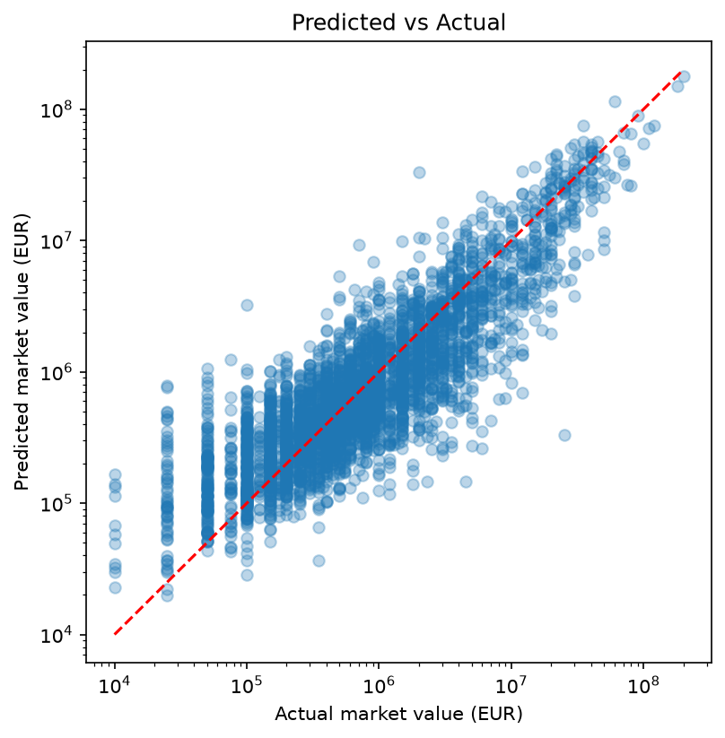
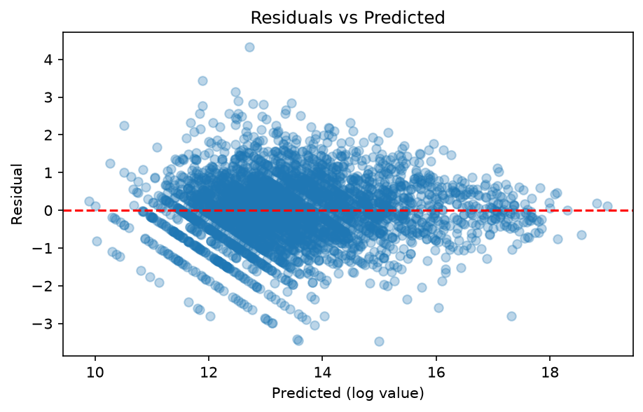

# Football Player Market Value Prediction

Machine learning project for **CSE570: Machine Learning with Python** (LPU).

## Problem Statement
Football clubs spend large sums on transfers, so an accurate estimate of a
player's market value helps them avoid overpaying. This project builds a
regression model to predict a player's market value (in EUR) from profile
attributes (age, position, height, foot, league) and on-pitch performance
(goals, assists, minutes, cards), and identifies which factors drive value most.

## Dataset
- **Source:** Football Data from Transfermarkt (David Cariboo), Kaggle:
  https://www.kaggle.com/datasets/davidcariboo/player-scores
- **Licence:** CC0: Public Domain
- **Tables used:** players.csv (profiles and market value), appearances.csv
  (one row per player per game)
- **Size:** about 50,000 players and about 1.89 million appearance records
- **Data currency:** the dataset is current to July 2026 (updates are paused),
  so market values reflect mid-2026.
- **Note:** appearances.csv (about 198 MB) is not stored in this repo. Download
  it from the Kaggle link above and place it in the data/ folder.

## Approach
1. Data cleaning and visualization
2. EDA and statistical analysis
3. Feature engineering and preprocessing pipeline (scaling and one-hot encoding fitted on training data only)
4. Model development: baseline, Linear Regression, Ridge, Lasso, Random Forest and Gradient Boosting, each tested with profile features only and with profile plus last-12-month performance features
5. Hyperparameter tuning of Gradient Boosting (grid search and randomized search with cross-validation)
6. Evaluation on a held-out test set and saving the final model
7. Flask web app to browse players and compare the model's estimate with their Transfermarkt value

## Results

All results are measured on 3,681 unseen players (20% test split, `random_state=42`). The target is modelled as log(1 + market value), and errors are also reported in euros after converting back.

**Final model: tuned Gradient Boosting**

| Metric | Default Gradient Boosting | Tuned Gradient Boosting |
|---|---|---|
| R² (log value) | 0.684 | **0.736** |
| RMSE (log value) | 0.898 | **0.820** |
| MAE (log value) | 0.696 | **0.624** |
| MAE (EUR) | 1,713,087 | **1,417,827** |

Best settings found by randomized search (3-fold CV, R² 0.730): 500 trees, max depth 6, learning rate 0.05, subsample 0.8.

**Model comparison (test set)**

| Model | R² profile only | R² profile + performance | MAE (EUR), with performance |
|---|---|---|---|
| Baseline (median) | -0.016 | -0.016 | 2,786,903 |
| Linear Regression | 0.530 | 0.653 | 1,962,993 |
| Ridge | 0.530 | 0.653 | 1,963,025 |
| Lasso | 0.525 | 0.648 | 1,970,852 |
| Random Forest | 0.588 | 0.696 | 1,630,743 |
| Gradient Boosting | 0.623 | 0.719 | 1,646,288 |
| Tuned Gradient Boosting | - | 0.736 | 1,417,827 |

**Findings**

- Adding last-12-month performance features improved every model.
- Tree-based models beat the linear models.
- Tuning raised R² from 0.684 to 0.736 and cut the mean error by about 300,000 EUR.
- The error grows with player value. Median percentage error by value band:

| Actual value | Median % error | Players |
|---|---|---|
| 10K to 200K | 81% | 831 |
| 200K to 400K | 36% | 666 |
| 400K to 900K | 38% | 730 |
| 900K to 3M | 47% | 808 |
| 3M and above | 47% | 646 |

- On the log scale the typical error is about 0.62, which means estimates are usually off by a factor of about 1.9, so the app shows a range instead of one exact figure.




## Limitations

- The data is a snapshot from mid-2026, so transfers and value changes after that date are not included.
- Market values are Transfermarkt estimates, not transfer fees.
- Roughly 55% of players have no appearances in the 12-month window, because the dataset covers only some leagues.
- Club identity, injuries and transfer history are not used.

## Run the web app

```
pip install -r requirements.txt
python app.py
```
Then open http://127.0.0.1:5000 and filter players by league, nation or position. The app reads `data/players_features.csv` and `models/best_model.joblib`.

## Project structure

```
data/           players_features.csv (appearances.csv is not stored, see above)
images/         plots
models/         best_model.joblib, feature_schema.json
notebooks/      01 data loading, 02 cleaning, 03 EDA, 04 modeling,
                05 feature engineering, 06 modeling with performance,
                07 tuning, 08 evaluation
reports/        report files
app.py          Flask app
templates/      HTML
static/         CSS and JavaScript
``